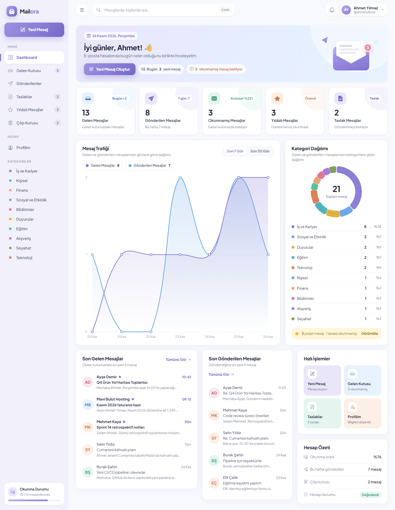
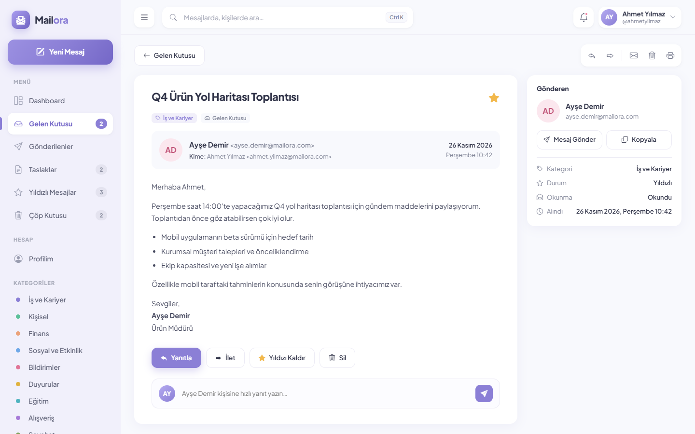
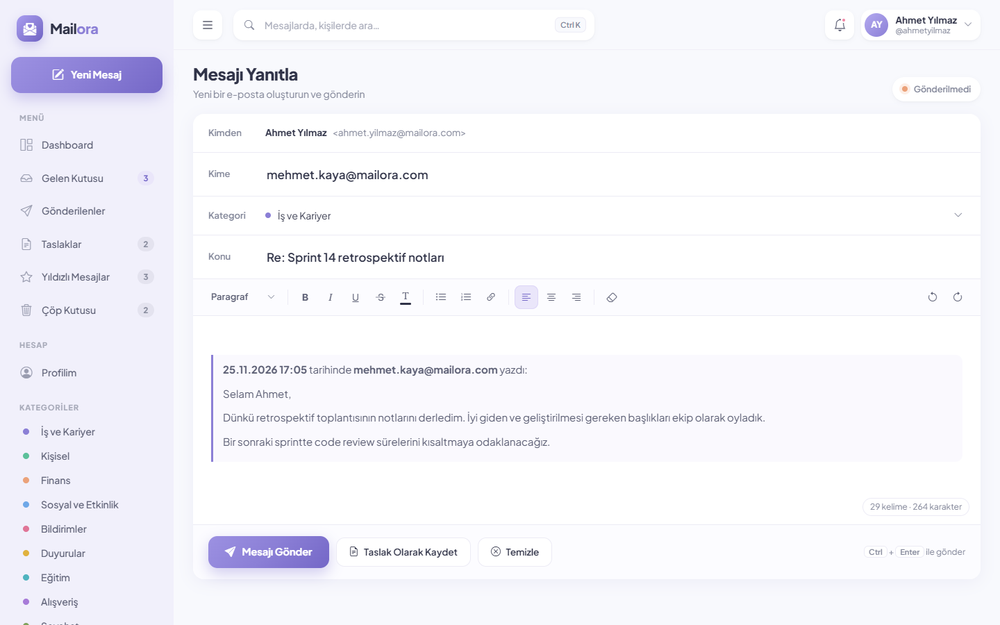
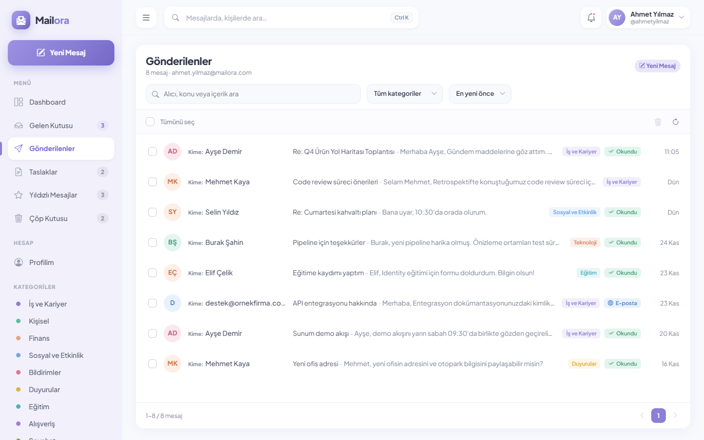
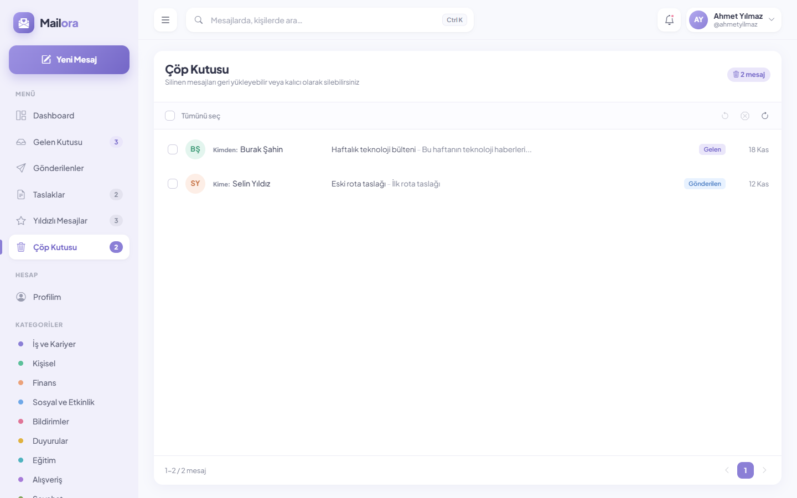
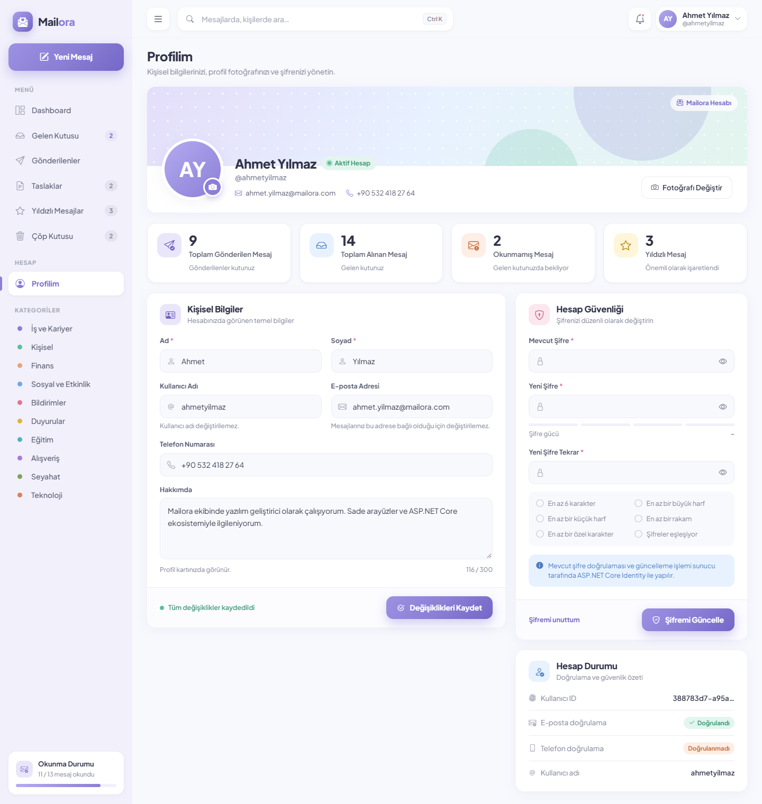
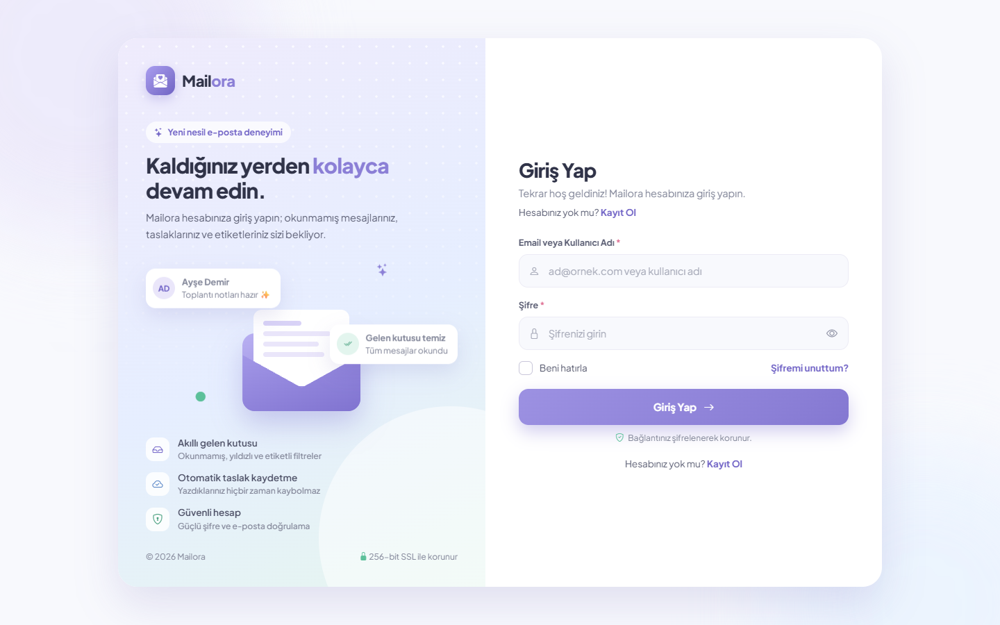
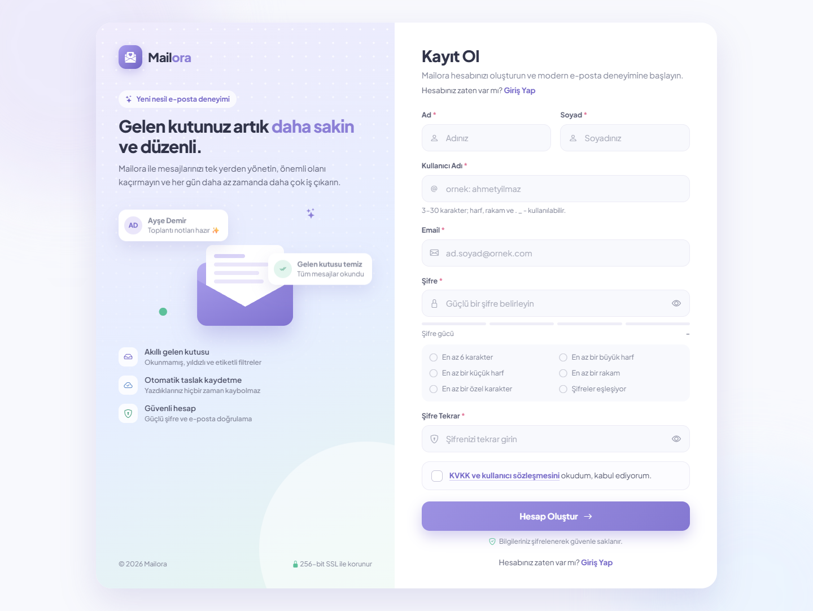
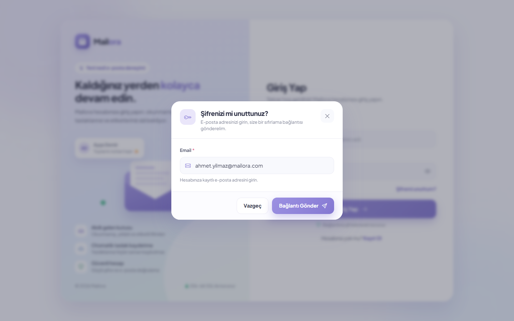
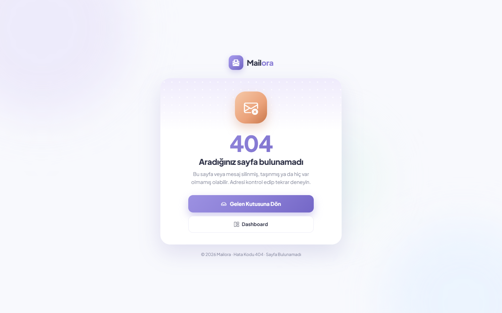

<div align="center">

# 📬 Mailora

**ASP.NET Core MVC, Identity ve Entity Framework Core ile geliştirilmiş, kullanıcıya özel çalışan e-posta yönetim sistemi**

Tüm mesajlar SQL Server'da tutulur; her kullanıcı yalnızca kendi gelen kutusunu, gönderilenlerini, taslaklarını ve çöp kutusunu görür.

[](https://dotnet.microsoft.com/)
[](https://learn.microsoft.com/aspnet/core/mvc/overview)
[](https://learn.microsoft.com/aspnet/core/security/authentication/identity)
[](https://learn.microsoft.com/ef/core/)
[](https://www.microsoft.com/sql-server)
[](https://github.com/jstedfast/MailKit)

[Ekran Görüntüleri](#-ekran-görüntüleri) •
[Özellikler](#-özellikler) •
[Mimari](#-mimari) •
[Kurulum](#-kurulum-ve-çalıştırma)

</div>

---

## 📸 Ekran Görüntüleri

> Ekran görüntülerindeki kullanıcılar ve mesajlar örnek (demo) verilerdir.

### 📊 Dashboard

<p align="center">
  <a href="docs/screenshots/05-dashboard.png"></a>
  <br><sub><b>Dashboard</b>: Gelen, gönderilen, okunmamış, yıldızlı ve taslak sayıları, mesaj trafiği grafiği, kategori dağılımı ve son mesajlar</sub>
</p>

### 📨 Mesaj Yönetimi

<table>
  <tr>
    <td width="50%" align="center">
      <a href="docs/screenshots/06-gelen-kutusu.png"></a>
      <sub><b>Gelen Kutusu</b>: Arama, kategori, sıralama, okunmamış ve yıldızlı filtreleri, toplu işlemler</sub>
    </td>
    <td width="50%" align="center">
      <a href="docs/screenshots/07-kategori-filtresi.png"></a>
      <sub><b>Kategori Filtresi</b>: Veritabanından gelen kategorilere göre süzülmüş liste</sub>
    </td>
  </tr>
  <tr>
    <td width="50%" align="center">
      <a href="docs/screenshots/08-mesaj-detay.png"></a>
      <sub><b>Mesaj Detayı</b>: Yıldızlama, okunmadı yapma, yanıtla, ilet, hızlı yanıt ve silme</sub>
    </td>
    <td width="50%" align="center">
      <a href="docs/screenshots/09-yanitla.png"></a>
      <sub><b>Yeni Mesaj / Yanıtla</b>: Zengin metin editörü, kategori seçimi ve taslak olarak kaydetme</sub>
    </td>
  </tr>
  <tr>
    <td width="50%" align="center">
      <a href="docs/screenshots/10-gonderilenler.png"></a>
      <sub><b>Gönderilenler</b>: Alıcının okuma durumu ve SMTP ile dış adrese giden mesajlar</sub>
    </td>
    <td width="50%" align="center">
      <a href="docs/screenshots/11-yildizli.png"></a>
      <sub><b>Yıldızlı Mesajlar</b>: Önemli olarak işaretlenen mesajlar</sub>
    </td>
  </tr>
  <tr>
    <td width="50%" align="center">
      <a href="docs/screenshots/12-taslaklar.png"></a>
      <sub><b>Taslaklar</b>: Düzenlenip daha sonra gönderilebilen taslaklar</sub>
    </td>
    <td width="50%" align="center">
      <a href="docs/screenshots/13-cop-kutusu.png"></a>
      <sub><b>Çöp Kutusu</b>: Geri yükleme ve kalıcı silme</sub>
    </td>
  </tr>
</table>

<p align="center">
  <a href="docs/screenshots/14-profil.png"></a>
  <br><sub><b>Profilim</b>: Kişisel bilgiler, profil fotoğrafı, mesaj istatistikleri, şifre değiştirme ve hesap durumu</sub>
</p>

### 🔐 Üyelik Ekranları

<table>
  <tr>
    <td width="50%" align="center">
      <a href="docs/screenshots/01-giris.png"></a>
      <sub><b>Giriş Yap</b>: Kullanıcı adı veya e-posta ile giriş, beni hatırla</sub>
    </td>
    <td width="50%" align="center">
      <a href="docs/screenshots/02-kayit.png"></a>
      <sub><b>Kayıt Ol</b>: Anlık doğrulama, şifre gücü göstergesi ve KVKK onayı</sub>
    </td>
  </tr>
  <tr>
    <td width="50%" align="center">
      <a href="docs/screenshots/03-eposta-dogrulama.png"></a>
      <sub><b>E-posta Doğrulama</b>: 6 haneli kod girişi ve kodu tekrar gönderme</sub>
    </td>
    <td width="50%" align="center">
      <a href="docs/screenshots/04-sifremi-unuttum.png"></a>
      <sub><b>Şifremi Unuttum</b>: Tek kullanımlık şifre yenileme bağlantısı isteği</sub>
    </td>
  </tr>
</table>

### 🚧 Hata Sayfaları

<table>
  <tr>
    <td width="33%" align="center">
      <a href="docs/screenshots/15-hata-401.png"></a>
      <sub><b>401</b>: Giriş yapmadan korumalı sayfaya erişim</sub>
    </td>
    <td width="33%" align="center">
      <a href="docs/screenshots/16-hata-403.png"></a>
      <sub><b>403</b>: Başka kullanıcıya ait mesaja erişim</sub>
    </td>
    <td width="33%" align="center">
      <a href="docs/screenshots/17-hata-404.png"></a>
      <sub><b>404</b>: Olmayan sayfa veya mesaj</sub>
    </td>
  </tr>
</table>

---

## 📖 Proje Hakkında

**Mailora**, kullanıcıların kayıt olup e-posta adreslerini doğruladıktan sonra birbirlerine mesaj gönderebildiği, kayıtlı olmayan adreslere de SMTP üzerinden gerçek e-posta iletebildiği bir mesaj yönetim sistemidir. Üyelik işlemlerinin tamamı **ASP.NET Core Identity** ile yapılır; panel sayfaları ortak bir layout üzerinde çalışır ve sidebar ile navbar oturumdaki kullanıcıya göre veritabanından beslenir.

---

## ✨ Özellikler

### Üyelik ve Güvenlik
- **Kayıt ve doğrulama:** Kayıt sonrası e-posta adresine 6 haneli kod gönderilir; kod doğrulanmadan giriş yapılamaz.
- **Giriş ve çıkış:** Kullanıcı adı veya e-posta ile giriş, "Beni hatırla" ve hatalı denemelerde geçici kilit.
- **Şifre işlemleri:** Tek kullanımlık, 30 dakika geçerli şifre yenileme bağlantısı; profilden mevcut şifreyle şifre değiştirme.
- **Hata ekranları:** Giriş yapmadan erişim **401**, başkasına ait mesaj **403**, olmayan sayfa veya mesaj **404**.
- **Veri güvenliği:** Tüm mesaj işlemleri oturumdaki kullanıcıya göre filtrelenir; URL'deki id değiştirilerek başkasının mesajına erişilemez.

### Mesaj Yönetimi
- **Gelen Kutusu:** Arama, kategori filtresi, tarihe göre sıralama, okunmamış ve yıldızlı filtreleri, toplu işlemler.
- **Mesaj Detayı:** Okundu / okunmadı, yıldızlama, yanıtla, ilet ve hızlı yanıt.
- **Yeni Mesaj:** Gönderen bilgisi Identity hesabından alınır, alanlar doğrulanır. Kayıtlı kullanıcıya giden mesaj alıcının Gelen Kutusu'na düşer; kayıtlı olmayan adreslere **MailKit** ile gerçek e-posta gönderilir.
- **Gönderilenler, Yıldızlılar, Taslaklar ve Çöp Kutusu:** Kullanıcıya özel listeler. Taslaklar düzenlenip gönderilebilir, çöp kutusundaki mesajlar geri yüklenebilir veya kalıcı olarak silinebilir.
- **Kategoriler:** Veritabanından gelir; mesaj oluştururken seçilir ve listeler kategoriye göre filtrelenir.

### Panel
- **Dashboard:** Gerçek verilerden hesaplanan sayaçlar, mesaj trafiği ve kategori dağılımı grafikleri, son mesajlar.
- **Profilim:** Ad, soyad, telefon, hakkımda ve profil fotoğrafı güncelleme.
- **Navbar ve Sidebar:** Kullanıcı bilgileri, yeni mesaj bildirimleri ve kutu rozetleri.

---

## 🧩 Mimari

Paneldeki sayfalar ortak layout'u kullanır; layout parçaları veritabanı bağlantısını Dependency Injection ile alan ViewComponent'lere ayrılmıştır:

```
MessageLayout/Index
├── _MessageLayoutStyleComponentPartial     head, tema CSS
├── _MessageLayoutSidebarComponentPartial   menü, rozetler, kategoriler       → Messages + Categories
├── _MessageLayoutNavbarComponentPartial    kullanıcı bilgisi, bildirimler    → AspNetUsers + Messages
├── @RenderBody()                           Dashboard, Message ve Profile sayfaları
└── _MessageLayoutScriptComponentPartial    ortak JavaScript
```

Üyelik ve hata sayfaları layout kullanmaz; Login, Register, ConfirmMail ve ErrorPages sayfalarının kendi Style / Script ViewComponent'leri vardır.

---

## 🧰 Teknolojiler

| Katman | Teknoloji |
|---|---|
| Backend | C#, ASP.NET Core MVC (.NET 9) |
| Kimlik Doğrulama | ASP.NET Core Identity, Cookie Authentication |
| Veri Erişimi | Entity Framework Core 9 (Code First + Migrations) |
| Veritabanı | Microsoft SQL Server Express |
| E-posta | MailKit / MimeKit (Gmail SMTP) |
| Arayüz | Razor Views, Bootstrap 5, Bootstrap Icons, Vanilla JavaScript |

---

## 📋 Gereksinimler

- [.NET 9 SDK](https://dotnet.microsoft.com/download), SQL Server (Express sürümü yeterli)
- Entity Framework Core CLI aracı: `dotnet tool install --global dotnet-ef`
- SMTP gönderimi için bir Gmail hesabı ve [uygulama şifresi](https://myaccount.google.com/apppasswords)

> [!IMPORTANT]
> Veritabanı bağlantı dizesi [Context/IdentityContext.cs](MYAcademy_IdentityEmailProject/Context/IdentityContext.cs) dosyasında `server=.\SQLEXPRESS` olarak tanımlıdır; farklı bir SQL Server örneği kullanıyorsanız değiştirin. SMTP hesap bilgileri `RegisterController`, `ConfirmMailController`, `PasswordChangeController` ve `MessageController` içindedir; kendi Gmail adresiniz ve uygulama şifrenizle değiştirin.

---

## 🚀 Kurulum ve Çalıştırma

```bash
git clone https://github.com/goktugcoskunsoyy/MYAcademy_IdentityEmailProject.git
cd MYAcademy_IdentityEmailProject/MYAcademy_IdentityEmailProject
dotnet restore
dotnet ef database update
dotnet run
```

Uygulama `https://localhost:7239/` adresinde giriş ekranıyla açılır. Visual Studio kullanıyorsanız migration'ları Package Manager Console'da `Update-Database` ile de uygulayabilirsiniz.

Kategoriler veritabanından gelir; ilk kurulumda `Categories` tablosuna kategori ekleyin:

```sql
INSERT INTO Categories (CategoryName)
VALUES (N'İş ve Kariyer'), (N'Kişisel'), (N'Finans'), (N'Eğitim'), (N'Teknoloji');
```

> [!NOTE]
> Doğrulanmamış hesaplar giriş yaparken doğrulama ekranına yönlendirilir ve "Tekrar gönder" ile yeni kod alabilir.

---

## 📁 Proje Yapısı

```
MYAcademy_IdentityEmailProject/
├── docs/screenshots/                         README ekran görüntüleri
├── MYAcademy_IdentityEmailProject.slnx       Çözüm dosyası
└── MYAcademy_IdentityEmailProject/
    ├── Context/                              IdentityContext (IdentityDbContext<AppUser>)
    ├── Controllers/                          Login, Register, ConfirmMail, PasswordChange, Dashboard,
    │                                         Message, Profile, ErrorPages
    ├── Entities/                             AppUser, Message, Category
    ├── Helpers/                              MessageHelper (avatar, özet metin, tarih, kategori rengi)
    ├── Migrations/                           EF Core migration dosyaları (mig1 - mig4)
    ├── Models/                               ViewModel'ler ve CustomIdentityValidator
    ├── VievComponents/
    │   ├── LoginViewComponents/              Giriş sayfası parçaları
    │   ├── RegisterViewComponents/           Kayıt sayfası parçaları
    │   ├── ConfirmMailViewComponents/        E-posta doğrulama sayfası parçaları
    │   ├── ErrorPagesViewComponents/         Hata sayfaları stili
    │   └── MessageLayoutViewComponents/      Panel layout parçaları (style, sidebar, navbar, script)
    ├── Views/
    │   ├── MessageLayout/                    Panelin ortak layout'u
    │   ├── Dashboard/, Message/, Profile/    Panel sayfaları
    │   ├── Login/, Register/, ConfirmMail/,
    │   │   PasswordChange/, ErrorPages/      Üyelik ve hata sayfaları
    │   └── Shared/Components/                ViewComponent görünümleri
    └── wwwroot/
        └── userimages/                       Yüklenen profil fotoğrafları
```

---

<div align="center">

**Göktuğ Talha Coşkunsoy**

[](https://github.com/goktugcoskunsoyy)
[](https://www.linkedin.com/in/goktugtalha/)

</div>
