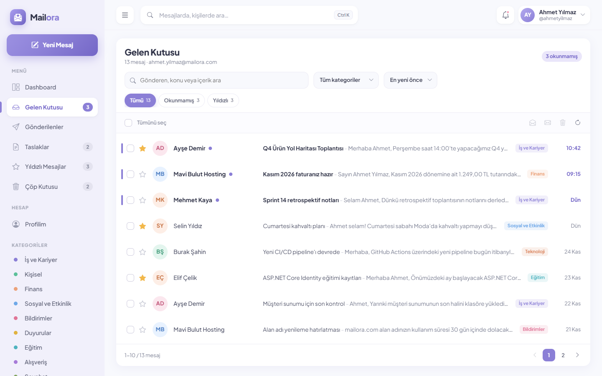
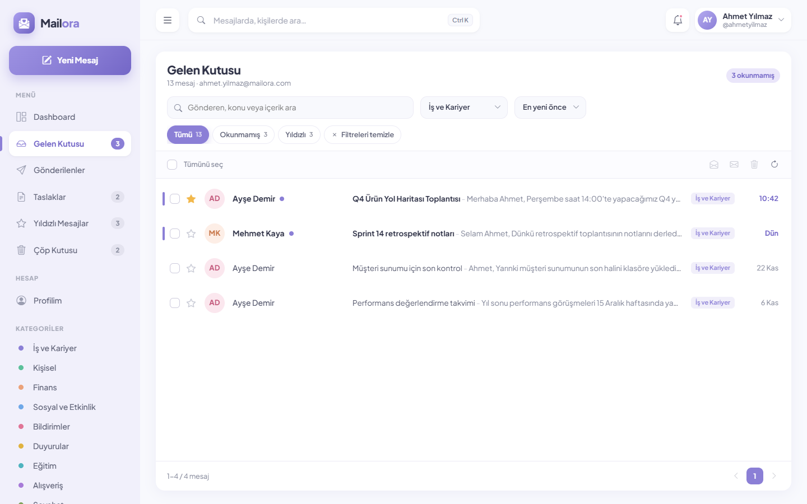
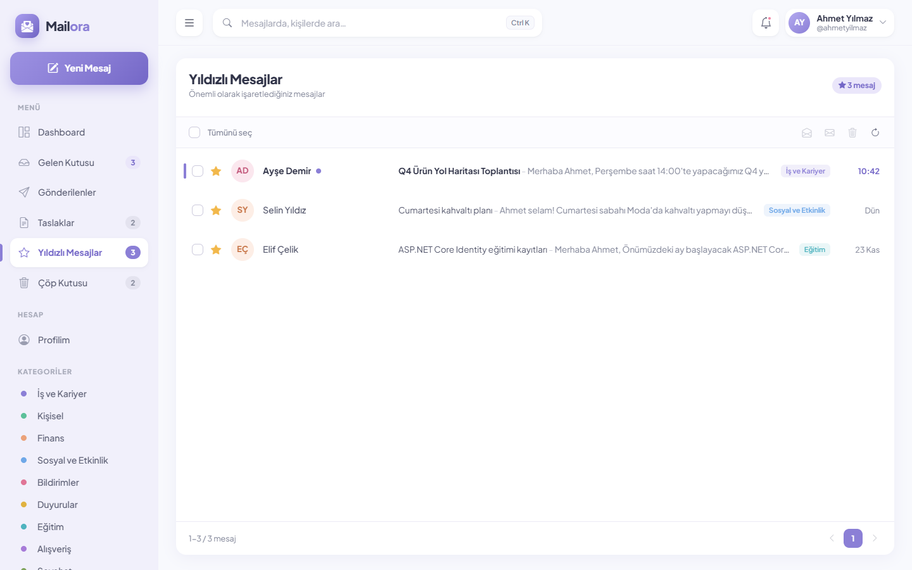
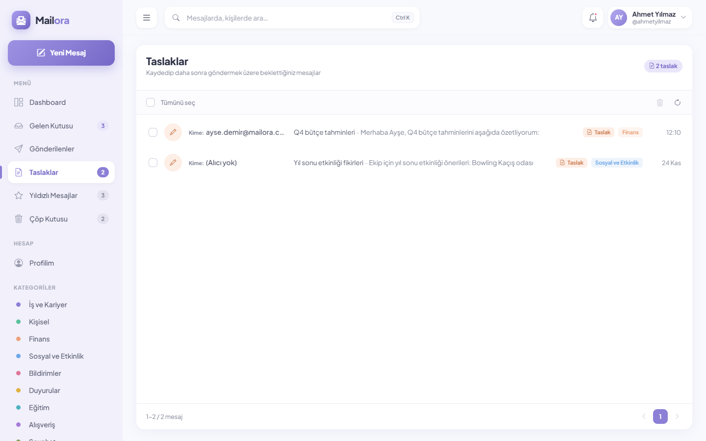
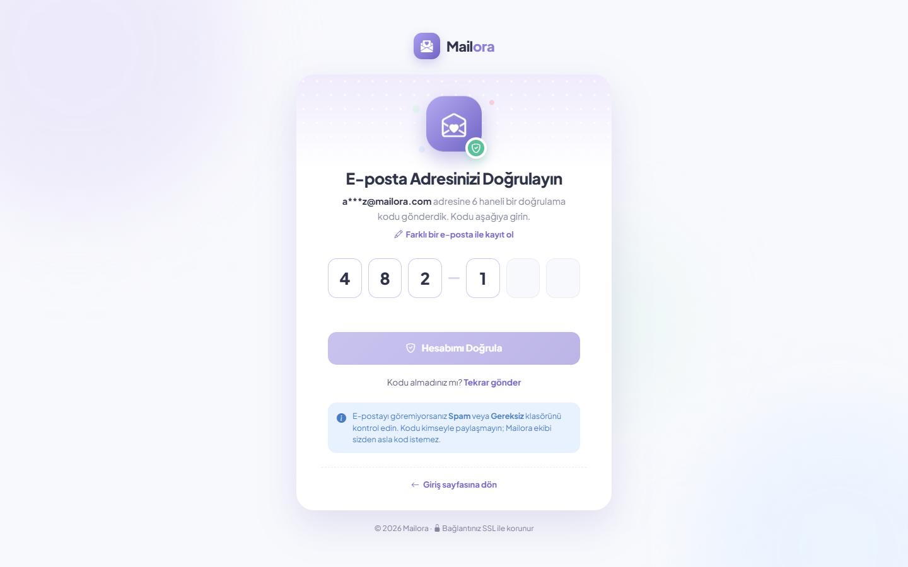
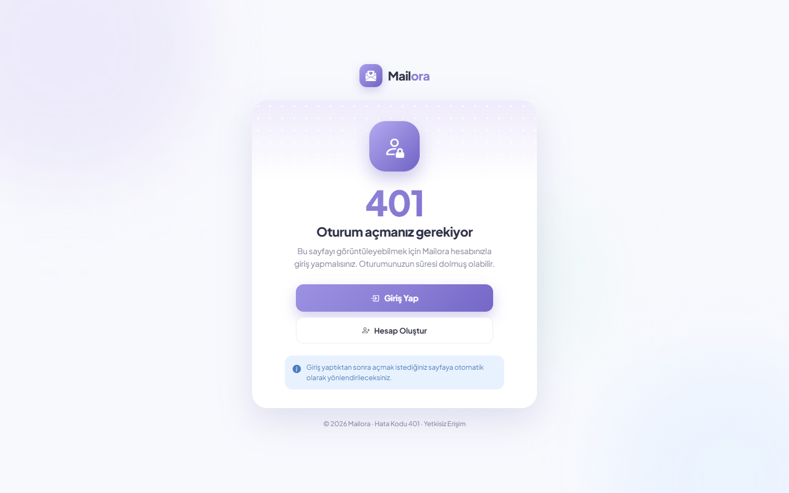
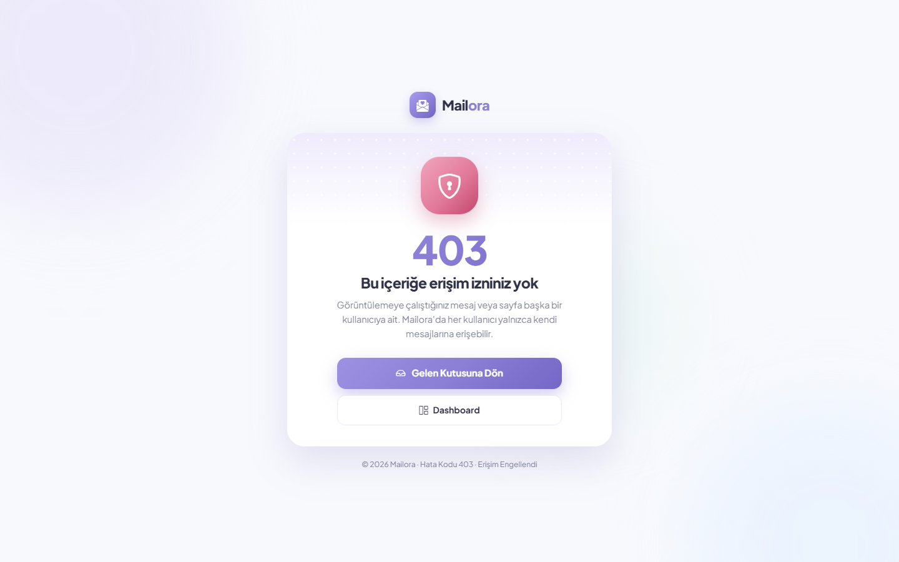

<div align="center">

# 📬 Mailora

**ASP.NET Core MVC, Identity ve Entity Framework Core ile geliştirilmiş, kullanıcıya özel çalışan e-posta yönetim sistemi**

Tüm mesajlar SQL Server'da tutulur; her kullanıcı yalnızca kendi gelen kutusunu, gönderilenlerini, taslaklarını ve çöp kutusunu görür.

[](https://dotnet.microsoft.com/)
[](https://learn.microsoft.com/aspnet/core/mvc/overview)
[](https://learn.microsoft.com/aspnet/core/security/authentication/identity)
[](https://learn.microsoft.com/ef/core/)
[](https://www.microsoft.com/sql-server)
[](https://github.com/jstedfast/MailKit)

[Ekran Görüntüleri](#-ekran-görüntüleri) •
[Özellikler](#-özellikler) •
[Mimari](#-mimari) •
[Kurulum](#-kurulum-ve-çalıştırma)

</div>

---

## 📸 Ekran Görüntüleri

> Ekran görüntülerindeki kullanıcılar ve mesajlar örnek (demo) verilerdir.

### 📊 Dashboard

<p align="center">
  <a href="docs/screenshots/05-dashboard.png"></a>
  <br><sub><b>Dashboard</b>: Gelen, gönderilen, okunmamış, yıldızlı ve taslak sayıları, mesaj trafiği grafiği, kategori dağılımı ve son mesajlar</sub>
</p>

### 📨 Mesaj Yönetimi

<table>
  <tr>
    <td width="50%" align="center">
      <a href="docs/screenshots/06-gelen-kutusu.png"></a>
      <sub><b>Gelen Kutusu</b>: Arama, kategori, sıralama, okunmamış ve yıldızlı filtreleri, toplu işlemler</sub>
    </td>
    <td width="50%" align="center">
      <a href="docs/screenshots/07-kategori-filtresi.png"></a>
      <sub><b>Kategori Filtresi</b>: Veritabanından gelen kategorilere göre süzülmüş liste</sub>
    </td>
  </tr>
  <tr>
    <td width="50%" align="center">
      <a href="docs/screenshots/08-mesaj-detay.png"></a>
      <sub><b>Mesaj Detayı</b>: Yıldızlama, okunmadı yapma, yanıtla, ilet, hızlı yanıt ve silme</sub>
    </td>
    <td width="50%" align="center">
      <a href="docs/screenshots/09-yanitla.png"></a>
      <sub><b>Yeni Mesaj / Yanıtla</b>: Zengin metin editörü, kategori seçimi ve taslak olarak kaydetme</sub>
    </td>
  </tr>
  <tr>
    <td width="50%" align="center">
      <a href="docs/screenshots/10-gonderilenler.png"></a>
      <sub><b>Gönderilenler</b>: Alıcının okuma durumu ve SMTP ile dış adrese giden mesajlar</sub>
    </td>
    <td width="50%" align="center">
      <a href="docs/screenshots/11-yildizli.png"></a>
      <sub><b>Yıldızlı Mesajlar</b>: Önemli olarak işaretlenen mesajlar</sub>
    </td>
  </tr>
  <tr>
    <td width="50%" align="center">
      <a href="docs/screenshots/12-taslaklar.png"></a>
      <sub><b>Taslaklar</b>: Düzenlenip daha sonra gönderilebilen taslaklar</sub>
    </td>
    <td width="50%" align="center">
      <a href="docs/screenshots/13-cop-kutusu.png"></a>
      <sub><b>Çöp Kutusu</b>: Geri yükleme ve kalıcı silme</sub>
    </td>
  </tr>
</table>

<p align="center">
  <a href="docs/screenshots/14-profil.png"></a>
  <br><sub><b>Profilim</b>: Kişisel bilgiler, profil fotoğrafı, mesaj istatistikleri, şifre değiştirme ve hesap durumu</sub>
</p>

### 🔐 Üyelik Ekranları

<table>
  <tr>
    <td width="50%" align="center">
      <a href="docs/screenshots/01-giris.png"></a>
      <sub><b>Giriş Yap</b>: Kullanıcı adı veya e-posta ile giriş, beni hatırla</sub>
    </td>
    <td width="50%" align="center">
      <a href="docs/screenshots/02-kayit.png"></a>
      <sub><b>Kayıt Ol</b>: Anlık doğrulama, şifre gücü göstergesi ve KVKK onayı</sub>
    </td>
  </tr>
  <tr>
    <td width="50%" align="center">
      <a href="docs/screenshots/03-eposta-dogrulama.png"></a>
      <sub><b>E-posta Doğrulama</b>: 6 haneli kod girişi ve kodu tekrar gönderme</sub>
    </td>
    <td width="50%" align="center">
      <a href="docs/screenshots/04-sifremi-unuttum.png"></a>
      <sub><b>Şifremi Unuttum</b>: Tek kullanımlık şifre yenileme bağlantısı isteği</sub>
    </td>
  </tr>
</table>

### 🚧 Hata Sayfaları

<table>
  <tr>
    <td width="33%" align="center">
      <a href="docs/screenshots/15-hata-401.png"></a>
      <sub><b>401</b>: Giriş yapmadan korumalı sayfaya erişim</sub>
    </td>
    <td width="33%" align="center">
      <a href="docs/screenshots/16-hata-403.png"></a>
      <sub><b>403</b>: Başka kullanıcıya ait mesaja erişim</sub>
    </td>
    <td width="33%" align="center">
      <a href="docs/screenshots/17-hata-404.png"></a>
      <sub><b>404</b>: Olmayan sayfa veya mesaj</sub>
    </td>
  </tr>
</table>

---

## 📖 Proje Hakkında

**Mailora**, kullanıcıların kayıt olup e-posta adreslerini doğruladıktan sonra birbirlerine mesaj gönderebildiği, gerçek e-posta adreslerine de SMTP üzerinden e-posta iletebildiği bir mesaj yönetim sistemidir. Proje iki bölümden oluşur:

- **Üyelik ekranları** (`/Login/SignIn`, `/Register/SignUp`): Giriş, kayıt, 6 haneli e-posta doğrulama, şifremi unuttum ve şifre yenileme sayfaları. Kimlik işlemlerinin tamamı **ASP.NET Core Identity** ile yapılır.
- **Mesaj paneli** (`/Dashboard`, `/Message`, `/Profile`): Giriş gerektiren, ortak layout üzerinde çalışan sayfalar. Sidebar ve navbar, oturumdaki kullanıcıya göre veritabanından beslenen ViewComponent'lerdir.

Proje, M&Y Yazılım Eğitim Akademi 12. dönem Identity e-posta case çalışması kapsamında geliştirilmiştir.

---

## ✨ Özellikler

### Üyelik ve Güvenlik
- **Kayıt ve 6 haneli doğrulama:** Kayıt sonrası e-posta adresine 6 haneli kod gönderilir. Kod doğrulanmadan giriş yapılamaz (`RequireConfirmedEmail`). Kod tekrar gönderilebilir, 5 hatalı denemede hesap geçici olarak kilitlenir.
- **Giriş ve çıkış:** Kullanıcı adı veya e-posta ile giriş, "Beni hatırla", 5 hatalı şifre denemesinde 5 dakikalık kilit, güvenli çıkış (POST).
- **Şifremi unuttum:** Tek kullanımlık, 30 dakika geçerli şifre yenileme bağlantısı e-posta ile gönderilir. Süresi dolmuş, daha önce kullanılmış veya hatalı bağlantılar yenileme ekranında reddedilir.
- **Şifre değiştirme:** Profil sayfasında mevcut şifre doğrulanarak yapılır; oturum kapanmadan yenilenir.
- **Hata ekranları:** Giriş yapmadan korumalı sayfaya erişim → **401**, başka kullanıcıya ait mesaja erişim → **403**, olmayan sayfa veya mesaj → **404**.
- **Veri güvenliği:** Tüm mesaj işlemleri oturumdaki kullanıcının e-posta adresine göre filtrelenir; URL'deki id değiştirilerek başkasının mesajı görüntülenemez veya değiştirilemez. Mesaj içeriği ekrana basılmadan önce DOMPurify ile temizlenir, tüm POST isteklerinde AntiForgery doğrulaması yapılır. Identity hata mesajları Türkçeleştirilmiştir (`CustomIdentityValidator`).

### Mesaj Yönetimi
- **Gelen Kutusu:** Yalnızca oturumdaki alıcıya gelen mesajlar. Arama, kategori filtresi, tarihe göre sıralama, Tümü / Okunmamış / Yıldızlı filtreleri, okunmamış mesaj sayısı, toplu okundu / okunmadı / silme işlemleri ve sayfalama.
- **Mesaj Detayı:** Açılan mesaj okundu olarak işaretlenir. Yıldızlama ve yıldız kaldırma, okunmadı yapma, yanıtla, ilet, hızlı yanıt, yazdırma ve çöp kutusuna taşıma.
- **Yeni Mesaj:** Gönderen bilgisi Identity hesabından alınır; alıcı, kategori, konu ve içerik hem istemci hem sunucu tarafında doğrulanır. Zengin metin editörü bulunur.
- **Gönderim:** Uygulamaya kayıtlı bir kullanıcıya gönderilen mesaj alıcının Gelen Kutusu'na ve gönderenin Gönderilenler alanına düşer. Kayıtlı olmayan adreslere **MailKit** ile SMTP üzerinden gerçek e-posta gönderilir.
- **Gönderilenler ve Yıldızlı Mesajlar:** Kullanıcıya özel listeler; gönderilenlerde alıcının mesajı okuyup okumadığı görünür.
- **Taslaklar:** Mesaj taslak olarak kaydedilir, daha sonra düzenlenip gönderilebilir.
- **Çöp Kutusu:** Mesajlar çöp kutusuna taşınır, geri yüklenir veya kalıcı olarak silinir. Gönderen ve alıcının silme işlemleri birbirini etkilemez.
- **Kategoriler:** Veritabanından gelir; mesaj oluştururken seçilir, sidebar'dan ve liste filtrelerinden mesajlar kategoriye göre süzülür.

### Panel
- **Dashboard:** Gelen, gönderilen, okunmamış, yıldızlı ve taslak mesaj sayıları gerçek verilerden hesaplanır. Son 7 / 30 günlük mesaj trafiği grafiği, kategorilere göre dağılım grafiği, son gelen ve son gönderilen 5 mesaj, hızlı erişim kısayolları.
- **Profilim:** Ad, soyad, telefon, hakkımda ve profil fotoğrafı güncelleme; mesaj istatistikleri ve hesap durumu.
- **Navbar ve Sidebar:** Oturumdaki kullanıcının adı, kullanıcı adı ve fotoğrafı; okunmamış mesaj bildirimleri; okunmamış, taslak, yıldızlı ve çöp kutusu rozetleri.

---

## 🧩 Mimari

Paneldeki tüm sayfalar ortak layout'u ([Views/MessageLayout/Index.cshtml](MYAcademy_IdentityEmailProject/Views/MessageLayout/Index.cshtml)) kullanır. Layout parçaları ViewComponent olarak ayrılmıştır ve veritabanı bağlantısını Dependency Injection ile alır:

```
MessageLayout/Index
├── _MessageLayoutStyleComponentPartial     head, Bootstrap, tema CSS
├── _MessageLayoutSidebarComponentPartial   menü, rozetler, kategoriler       → Messages + Categories
├── _MessageLayoutNavbarComponentPartial    kullanıcı bilgisi, bildirimler    → AspNetUsers + Messages
├── @RenderBody()                           Dashboard, Inbox, Sendbox, Favorites, Drafts, Trash,
│                                           MessageDetail, CreateMessage, Profile
└── _MessageLayoutScriptComponentPartial    ortak JS: toast, toplu seçim, sayfalama, DOMPurify
```

Üyelik ve hata sayfaları layout kullanmaz; her biri kendi ViewComponent'lerinden oluşur:

```
Login/SignIn, PasswordChange/*   → _LoginStyle, _LoginBrand, _LoginTerms (şifre sıfırlama modalı), _LoginScript
Register/SignUp                  → _RegisterStyle, _RegisterBrand, _RegisterTerms (KVKK modalı), _RegisterScript
ConfirmMail/Index                → _ConfirmMailStyle, _ConfirmMailScript (6 haneli kod alanı)
ErrorPages/Page401, 403, 404     → _ErrorPagesStyle
```

Bir mesaj, gönderen ve alıcı için tek kayıt olarak tutulur. Her iki tarafın durumu ayrı alanlarla izlenir:

| Alan | Açıklama |
|---|---|
| `IsRead`, `IsFavorite` | Alıcının okundu ve yıldız bilgisi |
| `IsDraft` | Henüz gönderilmemiş taslak |
| `IsTrashBySender`, `IsTrashByReceiver` | Gönderenin / alıcının çöp kutusunda |
| `IsDeletedBySender`, `IsDeletedByReceiver` | Gönderenin / alıcının kalıcı olarak sildiği; iki taraf da sildiğinde kayıt veritabanından kaldırılır |

---

## 🧰 Teknolojiler

| Katman | Teknoloji |
|---|---|
| Backend | C#, ASP.NET Core MVC (.NET 9), ViewComponents |
| Kimlik Doğrulama | ASP.NET Core Identity (`AppUser : IdentityUser`), Cookie Authentication |
| Veri Erişimi | Entity Framework Core 9 (Code First + Migrations) |
| Veritabanı | Microsoft SQL Server Express |
| E-posta | MailKit / MimeKit (Gmail SMTP) |
| Doğrulama | Data Annotations, `ModelState`, AntiForgery |
| Arayüz | Razor Views, Bootstrap 5, Bootstrap Icons, Vanilla JavaScript |
| Grafik ve Güvenlik | Chart.js, DOMPurify |

---

## 📋 Gereksinimler

- [.NET 9 SDK](https://dotnet.microsoft.com/download)
- SQL Server (Express sürümü yeterli)
- Entity Framework Core CLI aracı:

```bash
dotnet tool install --global dotnet-ef
```

- SMTP gönderimi için bir Gmail hesabı ve [uygulama şifresi](https://myaccount.google.com/apppasswords)

> [!IMPORTANT]
> Veritabanı bağlantı dizesi [Context/IdentityContext.cs](MYAcademy_IdentityEmailProject/Context/IdentityContext.cs) dosyasında `server=.\SQLEXPRESS` olarak tanımlıdır. Farklı bir SQL Server örneği kullanıyorsanız çalıştırmadan önce `server` değerini kendi örneğinizle değiştirin (örn. `localhost` veya `(localdb)\MSSQLLocalDB`).

> [!IMPORTANT]
> SMTP hesap bilgileri `RegisterController`, `ConfirmMailController`, `PasswordChangeController` ve `MessageController` içinde tanımlıdır. Kendi Gmail adresiniz ve uygulama şifrenizle değiştirin.

---

## 🚀 Kurulum ve Çalıştırma

```bash
git clone https://github.com/goktugcoskunsoyy/MYAcademy_IdentityEmailProject.git
cd MYAcademy_IdentityEmailProject/MYAcademy_IdentityEmailProject
dotnet restore
dotnet ef database update
dotnet run
```

- **Giriş ekranı:** `https://localhost:7239/`
- **Kayıt ekranı:** `https://localhost:7239/Register/SignUp`
- **Dashboard:** `https://localhost:7239/Dashboard/Index`

`dotnet ef database update` komutu dört migration'ı sırayla uygular: `mig1` (Identity tabloları, Categories, Messages), `mig2` (ReceiverEmail kolon adı düzeltmesi), `mig3` (doğrulama kodu alanı) ve `mig4` (taslak, çöp kutusu ve kalıcı silme alanları, isteğe bağlı kategori). Visual Studio kullanıyorsanız aynı işlemi Package Manager Console'da `Update-Database` ile yapabilirsiniz.

Kategoriler veritabanından gelir; ilk kurulumda `Categories` tablosuna kategori ekleyin:

```sql
INSERT INTO Categories (CategoryName)
VALUES (N'İş ve Kariyer'), (N'Kişisel'), (N'Finans'), (N'Eğitim'), (N'Teknoloji');
```

> [!NOTE]
> E-posta doğrulaması zorunlu olduğu için doğrulanmamış hesaplar giriş yaptığında doğrulama ekranına yönlendirilir ve "Tekrar gönder" ile yeni kod alabilir. Test hesaplarını doğrudan onaylamak için:
> ```sql
> UPDATE AspNetUsers SET EmailConfirmed = 1 WHERE Email = 'ornek@mail.com';
> ```

Profil sayfasından yüklenen fotoğraflar `wwwroot/userimages` klasörüne kaydedilir.

---

## 📁 Proje Yapısı

```
MYAcademy_IdentityEmailProject/
├── docs/screenshots/                         README ekran görüntüleri
├── MYAcademy_IdentityEmailProject.slnx       Çözüm dosyası
└── MYAcademy_IdentityEmailProject/
    ├── Context/                              IdentityContext (IdentityDbContext<AppUser>)
    ├── Controllers/                          Login, Register, ConfirmMail, PasswordChange, Dashboard,
    │                                         Message, Profile, ErrorPages
    ├── Entities/                             AppUser, Message, Category
    ├── Helpers/                              MessageHelper (avatar, özet metin, tarih, kategori rengi)
    ├── Migrations/                           EF Core migration dosyaları (mig1 - mig4)
    ├── Models/                               ViewModel'ler ve CustomIdentityValidator
    ├── VievComponents/
    │   ├── LoginViewComponents/              Giriş sayfası parçaları
    │   ├── RegisterViewComponents/           Kayıt sayfası parçaları
    │   ├── ConfirmMailViewComponents/        E-posta doğrulama sayfası parçaları
    │   ├── ErrorPagesViewComponents/         Hata sayfaları stili
    │   └── MessageLayoutViewComponents/      Panel layout parçaları (style, sidebar, navbar, script)
    ├── Views/
    │   ├── MessageLayout/                    Panelin ortak layout'u
    │   ├── Dashboard/, Message/, Profile/    Panel sayfaları
    │   ├── Login/, Register/, ConfirmMail/,
    │   │   PasswordChange/, ErrorPages/      Üyelik ve hata sayfaları
    │   └── Shared/Components/                ViewComponent görünümleri
    └── wwwroot/
        └── userimages/                       Yüklenen profil fotoğrafları
```

---

<div align="center">

**Göktuğ Talha Coşkunsoy**

[](https://github.com/goktugcoskunsoyy)
[](https://www.linkedin.com/in/goktugtalha/)

</div>
